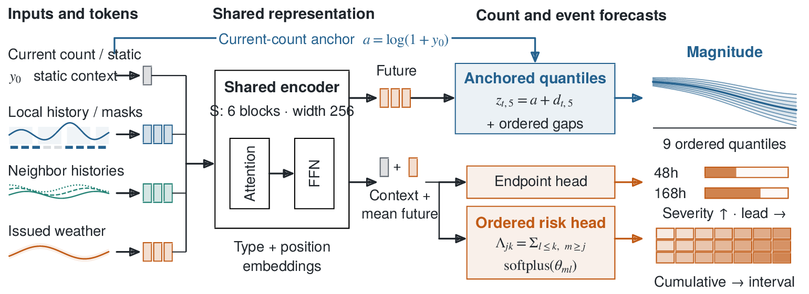

# OutageFM

Code for *OutageFM: Learning Transferable Outage Forecasts from Outage Persistence and Event Risk*.

Preparing for power outages needs two forecasts from one county count series: how many customers will remain out
during an ongoing interruption, and whether a large outage will start within a planning window. Per-step forecasts
cannot recover the second, because new outages are brief while their onset is spread over days: the window risk
implied by per-step probabilities under perfectly correlated paths falls short of the true risk by a fraction that
approaches one as onset disperses. OutageFM is a county-level forecaster with one shared encoder and separate
magnitude and event heads. It anchors ordered count quantiles to the current outage count and supervises event
probabilities directly with a cumulative-hazard head nested across leads and thresholds, using only weather forecasts
and NWS warnings issued before each forecast origin.



## Method

- **Shared regional encoder.** A Transformer reads a context token (current count, history statistics, static
  attributes, horizon, NWS warnings in force), 4-hour patches of 14 days of local history, one token for each of the
  32 nearest counties, and 4-hour patches of issued weather, warning coverage and calendar variables.
- **Count-anchored quantiles.** For every quarter hour, the quantile head predicts a shift of the median from
  log(1 + y0) and positive gaps between the nine quantiles 0.1, ..., 0.9, so ongoing outages are a reference, not a
  quantity to relearn, and quantiles never cross.
- **Direct event supervision.** An endpoint head, trained with the encoder, predicts an 800-customer event within 48
  and 168 hours. A risk head, fitted on the frozen encoder, predicts P(max Y_t >= c) for 7 leads (6-168 h) and
  3 thresholds (100, 800, 5,000 customers) as a double cumulative sum of positive hazard increments, so its
  probabilities increase with lead and decrease with threshold by construction; Platt maps per cell and an
  order-restoring map recalibrate it.
- **Training.** Historical pretraining on 2014-2021 outage windows without weather; weather adaptation on 2014-2023
  windows with issued weather and warnings, replaying one historical batch every three updates. The final model
  averages six members (four S backbones of 5.4M parameters and two M backbones of 33.5M) in count space.

## Contents

Included: the `outagefm` package (data pipeline, model, training, sharded evaluation, risk head), the scripts that
download and prepare the public data, rebuild and verify the frozen splits, train every OutageFM model of the paper
(ensemble members, risk heads, ablations, label budgets, risk-head structures, control heads, local adaptation),
evaluate them, recalibrate the risk head and select the ensemble, and one config per run.

Not included in this release:

- the baselines (persistence, anchored empirical quantiles, LightGBM, time-series foundation models, Chronos-2
  adaptation, DeepAR, PatchTST, the graph model) and their configs; the evaluator still accepts other model kinds
  through an optional `baseline/` package;
- the statistical analyses and figure scripts of the paper (bootstrap intervals, the descriptive findings of
  Section 2, the window-risk scoring of the dense-marginal and trajectory controls, the Chronos-2 risk head, the
  storm-day and cost-loss analyses);
- trained checkpoints, the processed panel, the manifests and the packed weather and warning stores.

## Installation

Python 3.11; run everything from the repository root.

```bash
conda create -y -p ./.venv python=3.11 pip
conda activate ./.venv
pip install torch==2.13.0 --index-url https://download.pytorch.org/whl/cu130   # match your CUDA
pip install -e '.[data,dev]'
cp .env.example .env    # optional
```

The reported results used torch 2.13.0, numpy 2.3.5, pandas 3.0.6, pyarrow 25.0.1 and scikit-learn on NVIDIA H200
and B200 GPUs. The `data` extra (eccodes, pyogrio) is needed only to prepare the weather archives and warnings.

## Configuration

Run settings live in `configs/` (YAML with `extends:` inheritance):

| File | Content |
|---|---|
| `configs/data.yaml` | Panel, forecast windows and the frozen splits; must match the `summary.json` of the built manifests |
| `configs/weather.yaml` | Issued weather fields and their fixed physical scaling |
| `configs/outagefm/base.yaml`, `adapt.yaml` | Encoder and heads (M size), pretraining and weather-adaptation recipes |
| `configs/outagefm/**/*.yaml` | One file per run (table below); `output_dir` is `runs/<run key>` |
| `configs/eval/*.yaml` | Evaluation settings for each weather-data variant and the ensemble |
| `configs/sources.json` | Public raw sources with their URLs and byte sizes |

Every weather-adaptation config names its initialization in `training.init_checkpoint` (`null` = random
initialization); `--init-checkpoint` on the command line overrides it, and an adaptation config without the key is
rejected. The shell drivers read optional settings from `.env` ([`.env.example`](.env.example)):

| Variable | Default | Content |
|---|---|---|
| `PYTHON` | `python` | Interpreter with `outagefm` installed |
| `NGPU` | all visible GPUs | GPUs for training and evaluation |
| `GLOBAL_BATCH` | `8192` | Global batch; per-GPU batch and gradient accumulation follow from it |
| `WEATHER_WORKERS` | `8` | Parallel downloads of the weather archives |

## Data and models

| Source | Role |
|---|---|
| EAGLE-I v4 county outage records, 2014-2025 (figshare) | Targets and outage history (quarter-hour panel of 3,259 counties) |
| GEFSv12 reforecast (2014-2019), operational GEFS control (2020-Feb 2021), GFS (from Feb 2021) | Issued weather: nine county fields per forecast hour |
| NWS VTEC watches, warnings and advisories (EAGLE-I VTEC table, IEM archives) | Warnings in force at the origin and issued for the window |
| NOAA Storm Events, IBTrACS | Removal of storm events that span split boundaries |
| Census county gazetteers | County coordinates and geography vintages |

```bash
bash scripts/prepare_data.sh            # all steps; or a subset: sources panel manifests weather variants warnings
python scripts/verify_manifests.py runs/verify-2y               # rebuild the splits and compare them field by field
python scripts/verify_manifests.py runs/verify-10y --adaptation-start 2014-01-15 \
  --frozen datasets/manifests/foundation-v2-wall
```

The splits are fixed by `configs/data.yaml`: daily 00 UTC origins; 2014-2021 for pretraining, adaptation windows up to
2023, 2024 for development and 2025 for testing, separated by a 21-day guard; Florida, Michigan, New York and
Washington form the geographic test, Colorado the geographic development set, and the other contiguous states and DC
the temporal test. Windows need 95% valid history and 80% valid targets. The NWS zone-county correlation files and the
EAGLE-I VTEC table have no stable direct link and are listed under `manual` in `configs/sources.json`; NOAA
republishes Storm Events files, so the recorded file versions are needed to reproduce the splits exactly.

## Running the pipeline

```bash
bash scripts/run_experiments.sh pretrain members risk select test
```

runs, in order:

1. `pretrain`: historical pretraining of the S, M and L backbones (`python -m outagefm.train --stage pretrain`);
2. `members`: weather adaptation of the six ensemble members, the two-weather-year OutageFM-S and the selection
   reference;
3. `risk`: the risk head on each frozen member, merged into its backbone (`scripts/merge_risk_field.py`);
4. `select`: evaluation on the full 2024 temporal development set and the selection score of Appendix B.3 (mean WQL
   and log-WQL ratio to `S-2y-fixed` at 48 and 168 hours; ties below 0.001 favour fewer members);
5. `test`: the 2025 temporal and geographic tests of the members and the ensemble, the risk-head evaluation
   (`scripts/evaluate_risk_field.py`) and its Platt recalibration with order restoration
   (`scripts/recalibrate_risk_field.py`).

Further stages reproduce the remaining experiments: `ablations` (Table 3), `budgets` (Figure 5), `structure`
(risk-head structures, Section 4.3), `controls` (dense-marginal and trajectory heads, Appendix A.3) and `local`
(Table 11). All runs use seed 42. Every stage is a sequence of the commands below, which can also be run on their own:

```bash
# Training (here 2 GPUs; the global batch of 8,192 is kept with gradient accumulation if needed)
python -m torch.distributed.run --standalone --nproc-per-node=2 -m outagefm.train \
  --config configs/outagefm/S-10y-warn.yaml --stage adapt --device cuda --batch-size 4096 --global-batch-size 8192
# Sharded evaluation (4 shards round-robin over the visible GPUs); writes <output>/h<H>/<split>/metrics.json
python scripts/evaluate_sharded.py configs/eval/10y.yaml runs/S-10y-warn/best.pt runs/S-10y-warn/test \
  test,geo_test 48,168
```

`metrics.json` reports WQL, log-WQL, median MAE, RMSE (average of the nine quantiles) and, for windows that start
with zero customers out (`window_event.quiet`), AP and Brier score of the endpoint event head.

Pretraining and `S-2y` stop at a wall-clock budget (`training.max_seconds`) and fix the cosine length from the update
rate measured after 300 updates, so their update counts depend on the hardware (29,652 S pretraining updates on
4 x H200); the other runs stop at `training.max_updates`. One S update takes about 0.17 s on 4 x H200 and 0.28 s on
2 x B200. A run resumes with `--resume runs/<run key>/last.pt` on the world size it started with.

## Variants

| Run key | Meaning |
|---|---|
| `pretrain-S`, `pretrain-M`, `pretrain-L` | Historical pretraining (5.4M, 33.5M, 103M parameters) |
| `S-10y-warn` | **OutageFM-S**: S, ten weather years (2014-2023), NWS warnings; reference of all ablations |
| `S-10y`, `S-10y-scratch` | S, ten weather years, no warnings; with and without historical pretraining |
| `S-gfs-warn` | S, GFS-period weather (March 2021-2023), warnings |
| `M-10y`, `M-10y-warn` | M, ten weather years, without and with warnings |
| `S-gfs-warn`, `S-10y`, `S-10y-warn`, `S-10y-scratch`, `M-10y`, `M-10y-warn` | The six members of **OutageFM** |
| `S-2y` | S, two weather years (2022-2023), no warnings ("2 weather yrs" in Table 2); initialization of `local/*` |
| `S-2y-fixed` | `S-2y` with a fixed update budget; reference of the ensemble selection score |
| `L-10y` | L, ten weather years (Appendix D.3; not in the ensemble) |
| `risk/<member>` | Risk head (double cumulative sum) on the frozen member |
| `risk/S-2y-{cumsum,lattice,independent}` | Risk-head structures: double cumulative sum, max-predecessor recurrence, unconstrained |
| `ablation/S-10y-warn-noanchor` | No count anchor (initialized from `ablation/pretrain-S-noanchor`) |
| `ablation/S-10y-warn-scratch` | No historical pretraining |
| `ablation/S-10y-noissued` | No issued weather or warnings in training and testing |
| `budget/S-10y-warn-{10,30,60}pct` | Nested label budgets of the ten-year adaptation pool |
| `control/marginal-{S,M}-10y-warn` | Dense per-step marginal head on the frozen backbone |
| `control/trajectory-S-10y-warn` | Trajectory generator trained with the energy score on the frozen backbone |
| `local/{full,head}-{FL,MI,NY,WA}-{7,30,90}d` | Local adaptation of `S-2y`: all parameters or heads only |

## Repository layout

```text
src/outagefm/          OutageFM package
  model.py             encoder, anchored quantile head, endpoint event head, risk and control heads, ensemble
  risk_field.py        nested cumulative-hazard construction and loss of the risk head
  neighbourhood.py     neighbouring-county histories (pre-origin only)
  train.py             pretraining, weather adaptation and frozen-backbone head fitting
  evaluate.py, merge.py, scoring.py, metrics.py   sharded, mask-aware evaluation
  data/                panel, manifests and datasets, issued-weather store, GPU input cache, downloads
scripts/
  prepare_data.sh, run_experiments.sh, common.sh   shell drivers
  download_sources.py, build_county_registry.py, build_transfer_splits.py, extend_adaptation_manifests.py,
  build_label_budgets.py, verify_manifests.py                                     outage data and splits
  prepare_gefs_reforecast.py, prepare_gefs_operational.py, prepare_gfs_forecasts.py,
  pack_gfs_forecasts.py, audit_gfs_forecasts.py                                   issued weather
  build_warning_catalog.py, pack_warnings.py                                      NWS warnings
  evaluate_sharded.py, evaluate_risk_field.py, merge_risk_field.py,
  recalibrate_risk_field.py, select_by_development.py                             evaluation and selection
configs/               data, weather, OutageFM runs and evaluation settings
assets/                overview figure
```

## License

Code is released under the [MIT license](LICENSE). EAGLE-I, NOAA, NWS and Census data keep their upstream terms.
